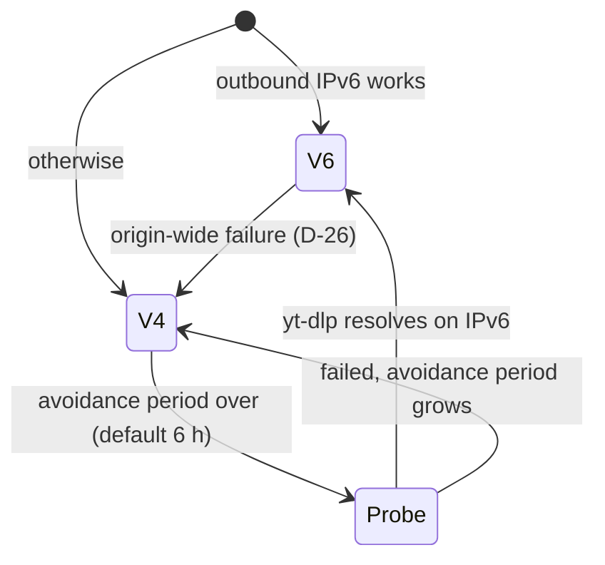

# Acquisition

How fragments reach the disk. Observed origin behaviour is in
[measured-facts.md](../reference/measured-facts.md).

## URL leases

A `UrlLease` is one resolved URL with its stream, itag, IP family and expiry. Leases are
reused until 30 minutes before `expire`, and cached in memory only: they contain the
client IP, so they are never persisted or logged.

```text
yt-dlp -4|-6 --live-from-start -f <itag> -j <url>  ->  .url
```

The family flag and the HTTP client always come from the same `IpFamily` value, so a
mismatch cannot be expressed. One `reqwest` client per family, using `local_address`
(`::` or `0.0.0.0`).

Repeated resolution failures back off exponentially per stream.

## IP family policy

The active family is global state, switched as a unit with its leases.



The `v4-first` policy swaps the roles. `v6-only` and `v4-only` disable the switch and
go to `error` instead. Each switch records time and reason for `doctor` and the UI.
Leases of the old family are dropped at the switch.

## Fragment fetch

```text
GET <lease.url>&sq=<n>
```

Response classification, applied in one pure function so it can be unit tested:

| Response | Outcome |
| --- | --- |
| 200 with body | Success. Capture head headers. |
| 200 empty | `Retryable`, counted towards the family failure. |
| 403 | `RefreshUrl`. Repeat after refresh: switch family. Repeat after switch: `error`. |
| 404 past head | `NotYet`, resynchronise from `X-Head-Seqnum`. |
| 404 older than the DVR | `Lost`, recorded as a gap. |
| 429, 503, 5xx | `Backoff`, exponential with jitter. |

Files are written to a unique temporary name, fsynced, then renamed, and the database row is
added last, so a row always means a complete file, and a rerun skips fragments that have one. The
sweep removes a file without a row, and a temporary file, once it is over an hour old, because a
younger one may belong to a running fetch.
Before the row is written, timing is read from the bytes (FR-A9), so a 200 that is not a
fragment is retried and never stored. WebM carries no duration, so its row records the stream's
fragment length. Timing is read from WebM and audio mp4 only, so `probe` rejects mp4 video.
Layout:

```text
/data/fragments/<stream_id>/<itag>/<sq div 10000>/<sq>
```

## Following the head

Following and backfill are independent. `streams.follow_sq` always stays at the head, and
everything behind it is a gap for backfill to fill, so a long backfill or one unfetchable
fragment never delays following.

```text
start or resume:
  head = current head from one fragment request
  record [follow_sq, head - 1], or the backfill window, as a gap
  follow_sq = head

loop:
  fetch follow_sq, record head headers
  on success, advance follow_sq in the same transaction as the fragment row
  if follow_sq falls too far behind: record a gap, jump to head
```

The origin holds a request just past the head until the fragment exists, so the loop needs
no timer ([spike S1](../reference/m0-spikes.md#s1-origin-behaviour-around-the-head)). The
request timeout is 30 s, several fragment durations. Head samples are stored at most once a
minute.

If the head does not advance, or yt-dlp reports the stream finished, the supervisor
confirms over a few attempts before moving to `ended`.

## Backfill, gaps and range fetches

- Backfill consumes `gaps` oldest-first, as a `net-low` job with a persisted checkpoint.
- A pause or outage is one gap record. On resume, it is filled while still in the DVR.
  What has expired is marked `lost`.
- `ensure-range` is the one job that fetches a range of any track. It creates the retention
  hold first, skips fragments already stored, and fails early if the range has left the DVR
  or the disk floor would be crossed.
- Prefetch is `ensure-range` for each candidate region with a 5-minute margin either side.
  A full-cycle export uses it for its whole range (FR-E13), about 8,500 fragments at the
  reference stream's period.

## Rate control

A single scheduler owns all fragment requests.

| Setting | Default | Notes |
| --- | --- | --- |
| Requests per second | 4 | Token bucket. Measured ceiling is about 5 at concurrency 4. |
| Concurrency | 4 | Global. |
| Priority | follow > prefetch > backfill | Strict. Following one stream needs 0.2 requests per second. |

The limiter is reduced to half for 10 minutes after any `Backoff` burst, because
limits are per request rather than per byte.

## Probing a new stream

Registration runs yt-dlp once, stores title, channel ID and thumbnail reference, chooses
formats (D-15) and fetches two adjacent fragments per candidate format to measure the
fragment length and to check keyframe-first and concatenation. That one call returns the URL
of every format, so probing needs no further yt-dlp call.

- **Head:** a request for `sq=1`, long out of the DVR, returns `X-Head-Seqnum` in its headers.
- **Audio:** the pair must be AAC-LC and contiguous to the tick.
- **Video:** at most four candidates, best first. ffprobe confirms that both fragments start
  with a keyframe and that joining them keeps every packet, and ffmpeg must copy the join into
  an mp4. Using these tools covers WebM and mp4 sources without more parsing code.

## Container reader

`core::container` parses a byte buffer and returns `Mp4Fragment { start_ticks, duration_ticks,
timescale, packets, audio_config }`, or a start time for WebM (D-21). It rejects malformed input
with errors, never panics, and has fuzz-style tests on truncated and corrupted buffers.

- **mp4:** `moof`/`traf`/`tfdt`, `trun` sample sizes, `mdat` offsets, `mdhd` timescale and
  the `AudioSpecificConfig`.
- **WebM:** Timecode scale and Cluster Timecode only. Packets are not needed, since video
  is never decoded in process.

ffprobe `start_time` is the test oracle.
