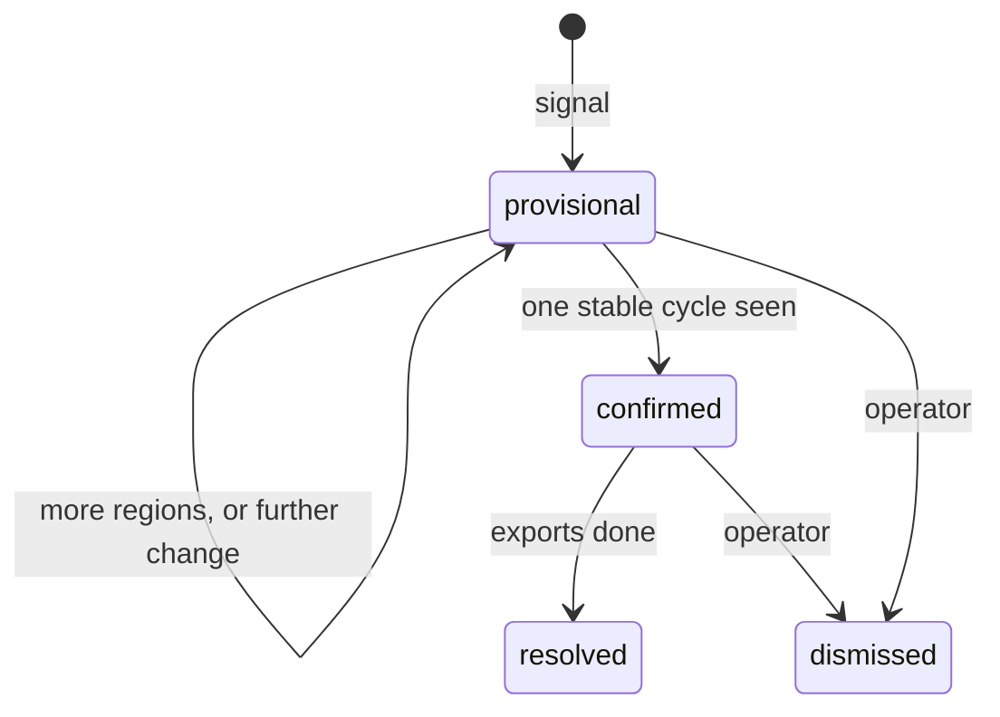

# Analysis

Algorithms in `core`, all pure functions over in-memory series. The baseline is the
10 Hz envelope. Milestone 7 replaces `diff` and `refine`, behind the same interfaces.

## Feature pipeline

Each contiguous run of stored audio has its own cursor in `feature_runs`, consumed in `sq`
order (D-07):

```text
audio fragment -> container reader -> AAC packets -> decoder (one per contiguous run)
  -> mono, 2 kHz -> 200-sample RMS -> log1p -> envelope row
```

- **Grid.** Within a run, sample position counts continuously from the run's anchor, which
  is what makes incremental output equal batch output. A bin is stored with the fragment
  whose processing completed it, which is later than where it starts because the resampler
  looks ahead. `first_bin` places it on the grid, so readers need not care.
- **Drift check.** If the sample position and measured `stream_time` disagree by over
  50 ms, log a warning and start a new run. This also covers the origin skipping time.
- **Restart.** Resume one fragment early, discarding output, to re-prime the decoder. AAC noise
  substitution draws from a generator that the restart cannot restore, so values after a
  restart can differ from an unbroken pass in the last bits. On real fragments, 3 of 1,000
  values differed, by at most 1e-6. An unbroken run equals a batch run exactly.
- **Gaps.** Reset the decoder, drop the partial bin and start a new run on the same grid.
- **Filled gaps.** A fill becomes a run that also recomputes the first fragment after the
  gap, which was decoded without its predecessor, and then merges with the following run.

Resampling uses a windowed-sinc filter rather than reproducing ffmpeg's exactly. The Python
envelopes are a compatibility reference, not a measure of accuracy: the thresholds in
[spike S4](../reference/m0-spikes.md#s4-envelope) catch regressions, and the known answers in
milestone 3 decide whether the envelope is good enough for analysis.

## Series

```rust
pub struct Series {
    pub start_time: f64,
    pub rate: f64,
    pub values: Vec<f32>,
    pub valid: Vec<bool>,
}
```

Analysis loads a `Series` from envelope rows. Holes are explicit. Before correlation,
invalid samples are filled with the local mean, and any window with more than 10%
invalid samples scores `None`.

## NCC

As specified in measured-facts section 4.2: numerator by real FFT, denominators by
cumulative sums in `f64`, with positions where `σ_e(k) ≤ 0.3 σ_r` scored as 0.

The result distinguishes three outcomes (D-05), and consumers must handle all of them:

```rust
pub enum Match { NoData, NoMatch, Lag { lag: f64, score: f32 } }
```

Property tests assert `|ncc| ≤ 1` up to rounding, including on silent input.

## Period estimation

1. Take six 600-second references, 30 minutes apart, ending near the tail.
2. For each, find peaks scoring at least 0.9 in the candidate range.
3. Take the **smallest** peak lag per reference (D-02), then the median.
4. Accept when at least four references agree within 2 s. A match at `2P` is recorded as
   added confidence (D-02).
5. Otherwise return `NoPeriod { testable_up_to }` (D-03).

The range defaults to 30 minutes to 24 hours and, once known, narrows to the tracking range.

## Lag tracking

Every 30 s, a 60-second reference is searched in `[max(P/2, P − 3 h), min(3P/2, P + 3 h)]`
(D-01, D-04). A reference whose target at `t − P` is invalid yields `NoData` (D-05).
Consecutive points with equal lag, within 1 s, form a `LagRun`. A short run with a
different lag on both sides is an `Outlier`, excluded from decisions. Outliers usually
come from known material, and are labelled as such when they overlap a known clip.

The threshold starts at 0.65 (range 0.6–0.7 from the measurements). Runs and the watermark
are persisted in each pass, so a restart loses nothing (D-25).

## Change detection

Evaluated after each tracking pass:

| Signal | Condition | Meaning |
| --- | --- | --- |
| Lag shift | A run of at least 10 minutes settles at `P + Δ`, `Δ ≠ 0` | Net change of Δ. |
| Unmatched run | A stretch of at least 4 points after a lasting lag that is not the same audio at that lag, or at least 4 consecutive `NoMatch` points where no lag applies. `NoData` splits a stretch and never counts (D-04, D-05). | New content, including a net-zero replacement. |
| Lost track | No stable run for 30 minutes | Widen the search until a run stabilises (D-01), and treat the interval as a transition (D-09). |

A lasting lag holds for 10 points, longer than repeated material plays. Single points say little,
as a window of flat music can match somewhere by chance, or match poorly where it should, so the
stretch is judged as a whole, as in version comparison. Score drops alone never fire. After any signal, the old and new period comparison at 5 s
steps narrows the start and end to within the window size (±30–60 s).

## Change lifecycle



A pass runs hourly as a job, locks the database only to read and to write, and overlaps the last
pass by an hour, as a signal needs the points before it. A settled lag signals from the start of
every pass, so only a new delta or later unmatched audio counts as a later signal. The cycle that
stands for the old version ends 11 minutes before the change, as comparison searches 10 minutes
past a cycle's ends and would find the new audio there.

Provisional creation enqueues prefetch, sets the DVR deadline and notifies. Confirmation
creates the version, holds its audio and features, runs diff and self-checks, and notifies
once more (D-08). Each state change commits together with its outbox row, so a crash can
neither lose nor duplicate an alert (D-25).

## Version comparison

Baseline, from measured-facts section 4.5:

1. Cut the current cycle into 60-second windows at 30-second steps.
2. Search each in every stored version's cycle, extended 10 minutes either side.
3. Per window, record best version, position and score.
4. Convert to `shift = t_new − t_old`, and detect where shift changes. A shift held for under
   5 minutes is a brief flip, because repeated material matches its other occurrences for as
   long as it plays.
   Silence or a gap between equal shifts is bridged. Any other gap between two lasting regions
   of one shift is judged as a whole at that shift, or at the shift of the region after it, as
   equal shifts can differ by the shift tolerance. Each is tried within 0.2 s because bins of
   two versions differ in phase: correlation of at least 0.3 and mean absolute difference of at most 0.35
   mean the same audio, provided no 120-second piece differs by more than 0.7, which keeps a
   short replacement from hiding in a long gap. This is one comparison, so it can be far weaker than a search over a
   cycle, and flat, loud music needs it, as its correlation collapses while its level stays
   close. Otherwise the gap is a replacement, which keeps the shift. Replacements of 90 s and
   longer are mostly found, as [the verification](../reference/m3-verification.md#replacements)
   measures.
5. Move region edges to about 3 s, by walking outwards from inside the region at a fixed shift
   with a 5-second window. A 60-second window straddling an edge matches nothing, or matches past
   the true edge.
6. Split each new region at the silences between videos, where audio stops, and judge each video
   alone. Between equal shifts a video that is the same audio goes back to existing; between
   different shifts this runs in from each end, as the change lies between them. When no video
   stands out the region stays whole. Edges of what stays new then move to a silence within 40 s.
7. Keep the heaviest chain of existing regions that follows the old order without overlapping.
   The rest are copies, such as repeated material placed in front of an addition, and count
   as inserted. Shift changes are taken along this chain.
8. Classify:

| Class | Rule |
| --- | --- |
| existing | Stable match in the previous version. |
| revival | No stable match in the previous version; stable match in an older one. |
| known | Overlaps a registered known clip. |
| new | No stable match anywhere. |
| deleted | Region of the previous version with no counterpart. |
| no data | Silence or a recording gap between different shifts. Never counted as inserted (D-05). |

The silences inside new regions are reported as video boundaries, as one region can join several
videos (FR-N13, D-31). Silences within 5 s of a region's edge belong to the edge.

The window search is rayon-parallel, using one FFT plan per thread.

## Self-checks

```rust
pub struct SelfCheck { name: String, expected: f64, actual: f64, tolerance: f64, passed: bool }
```

- Sum of shift changes equals the period change.
- Inserted (new, revival and known regions) minus deleted equals the period change.
- The silences between videos in existing regions recur at the matched shift. At most 10% may be
  missing, and audio with no silences gives no check. Silences come from the level alone, so unlike
  the other two this does not rest on region lengths. It does not find changes (D-30).

Tolerance starts at 5 s (the known example is off by 1 s). Lengths depend on region edges, each
good to about 3 s, so the second check allows at least 3 s per edge. A failure asks for human
review and never blocks the workflow.

The second check is weaker than it looks. Regions divide each cycle without gaps, so it mostly
restates the first, and on the known example they agree to the tenth of a second. Treat a pass as
a sanity check, not as independent evidence.

## Evaluation (milestone 7)

The harness is built before any algorithm is replaced. Inputs are the known answers and
synthetic cases: volume change, noise, repeated inserts, replacements with deletion,
equal-length replacement, and period shrinkage. Output is a stored report of boundary
error and precision/recall per commit of interest. Replacements proceed in this order:
segment alignment by offset voting, known-material masking with full-history matching,
richer features, sub-second boundaries. Each must improve the report.
