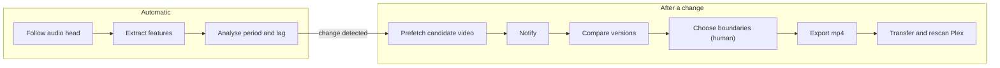
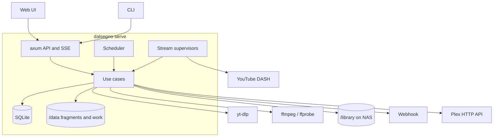
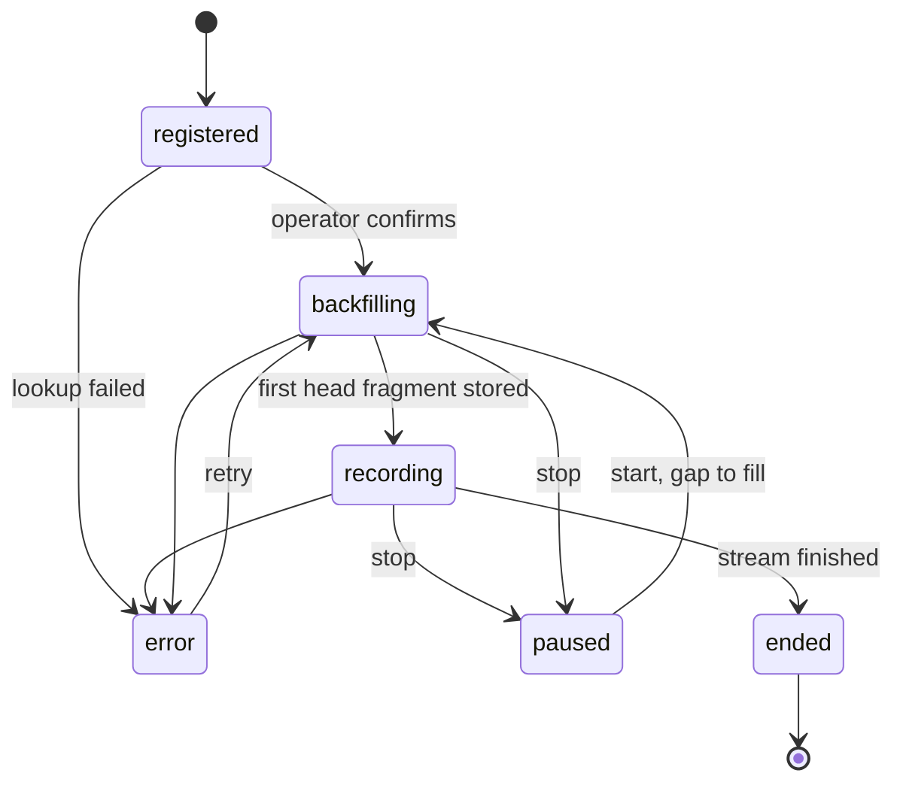

# Architecture

One Rust binary. `dalsegno serve` records, analyses, runs jobs and serves the API
and Web UI. Other subcommands are clients of that API, except offline analysis.

Companion documents: [acquisition](acquisition.md), [analysis](analysis.md),
[data model](data-model.md), [export](export.md), [API and CLI](api.md).

## Processing flow

Three steps run unattended. Six follow a detected change, and the human decision
sits at the boundary step.



## System context

Web UI and CLI call the same API. Five things are external: YouTube, yt-dlp,
ffmpeg, the NAS library and the notification webhook. Plex is reached over HTTP.



## Workspace

Dependencies point downward only. `core` performs no I/O, which keeps the
algorithms testable on synthetic data and usable offline.

| Crate | Responsibility | Depends on |
| --- | --- | --- |
| `cli` | Binary, clap commands, API client, offline commands | `app`, `server` |
| `server` | axum API, SSE, scheduler, job runner, stream supervisors, embedded UI | `app` |
| `app` | Use cases, policies (IP family, retention), domain errors | `core`, `io`, `store` |
| `io` | yt-dlp, HTTP fetcher, ffmpeg, Plex and webhook adapters | `core` |
| `store` | SQLite access, migrations, repositories | `core` |
| `core` | Types, container reader, features, NCC, period, tracking, diff, time map, naming | none |

```text
crates/{core,store,io,app,server,cli}/
web/                 Svelte + Vite source, output embedded with rust-embed
docs/
Dockerfile
```

`io::ytdlp` is the only code that knows yt-dlp's arguments and JSON (NFR-7). `app`
sees it through a trait, so tests substitute a fake.

## Runtime model

- **Stream supervisor.** One tokio task per active stream, owning its follow loop
  and state transitions. It is not a job, because it never finishes.
- **Scheduler.** Enqueues hourly analysis and retention sweeps, and evaluates DVR
  deadlines.
- **Job runner.** Claims jobs from the database, per resource class:

  | Class | Slots | Kinds |
  | --- | --- | --- |
  | `net-low` | 1 | backfill, `ensure-range` |
  | `cpu` | 1 | features catch-up, analysis, diff |
  | `ffmpeg` | 1 | candidates, assembly, preview |
  | `transfer` | 1 | library transfer, Plex |

- **Blocking work.** CPU work uses `spawn_blocking` and rayon so the follow loop
  stays responsive (NFR-5).
- **Notifier.** Drains the `notifications` outbox with retry (D-25).
- **Database.** WAL mode. One writer thread runs whole transactions sent over a channel,
  and readers use short-lived connections.
- **Crash recovery.** On start, jobs in `running` return to `queued`. Every job is
  idempotent and resumes from its checkpoint (NFR-3).

## Stream states



"No loop detected" is a property of a recording stream, not a state: recording
continues, and change detection is off.

## Configuration

Bootstrap settings come from `~/.config/dalsegno/config.toml`, or the file `DALSEGNO_CONFIG`
names, and from environment variables prefixed `DALSEGNO_`, which win: data and library paths,
bind address (`127.0.0.1:8737` by default), cookie file, webhook URL and format (`slack`,
`mattermost` or `ntfy`), public URL, Plex URL and
token. The work area sits under the data path. Operational settings will start there and can be
overridden in the database:
IP family policy, rate limits, retention, disk floor, analysis thresholds (D-24). Secrets
are never exposed by `GET /settings`. Per-stream settings live in the database.

## Security

The threat model is a trusted LAN or VPN, such as Tailscale, with an authenticating reverse
proxy (D-20).

| Concern | Control |
| --- | --- |
| Exposure | Bind `127.0.0.1` unless configured. Reject state-changing requests with a foreign `Origin`. |
| Command injection | Child processes take argument vectors, never a shell. Video IDs must match `^[A-Za-z0-9_-]{11}$`. Paths given to ffmpeg are absolute. |
| Path traversal | Output names reject separators, control characters and leading dots, and are limited to 200 bytes after NFC normalisation. Resolved paths must stay under the library root. |
| Secret leakage | A `Redacted` wrapper for fragment URLs, cookies and tokens. Logs carry the stream and `sq`, never query strings. |
| IP leakage | `info.json` is written from an allowlist of keys, excluding those in FR-E9. A test asserts none of them survive. |
| Cookies | Read from a file passed by path, kept out of the database and the UI. |
| Disk exhaustion | Free-space floor for prefetch, retention sweeps, visible usage. |

## Deployment

yt-dlp and ffmpeg are commands that `dalsegno` runs as child processes, not services, so
they ship in one image. Separate containers would force either mounting the Docker socket
and using `docker exec`, which hands over host-wide privileges, or writing a call-forwarding
API, and would add passing large video files between containers. Only services independent
of `dalsegno` run separately, such as an authenticating reverse proxy or a self-hosted
notification server, and existing homelab instances are sufficient.

The service runs on a homelab server, for example under systemd or Docker in a Proxmox LXC.
The work area is on local disk, and finished output is transferred to the NAS library.

- **Build stages:** Node builds `web/`, Rust builds the binary with the UI embedded,
  and a slim runtime carries the binary, ffmpeg, standalone yt-dlp and Deno.
- **yt-dlp:** pinned with `ARG YTDLP_VERSION`. Renovate watches the yt-dlp GitHub releases
  and opens and auto-merges a version bump, CI builds and publishes the image, and Watchtower
  or existing GitOps swaps it in. If URL resolution starts failing before the rebuild lands,
  the stream enters `error` and the notification suggests that update.
- **Image:** CI publishes `ghcr.io/a24k/dalsegno` only once its other jobs pass. `main` gives
  `main` and `sha-<commit>`. A tag `v1.2.3` gives `1.2.3`, `1.2` and `latest`, and must match
  `Cargo.toml` (D-32).
- **Volumes:** `/data` local disk, `/config` settings and cookie, `/library` NAS.
- **User:** runs as the library owner's uid:gid.
- **IPv6:** needs `enable_ipv6` with an address range, or host networking; otherwise IPv4
  is used.
- **Optional:** `/dev/dri` for VAAPI decoding during black detection. When Docker runs in a
  Proxmox LXC, the device must also be passed through at the LXC level.

## Technology

Rust edition 2024. Main crates, checked against crates.io on 2026-10-31: clap 4,
tokio 1, axum 0.8, tower-http 0.7, reqwest 0.13 (`rustls` feature, default features
off), rusqlite 0.41 (`bundled`), realfft 3, rayon 1, symphonia 0.6 (AAC only),
serde, serde_json, toml 1, chrono, chrono-tz (`Asia/Tokyo` for display), tracing, anyhow in
binaries, thiserror in libraries, rust-embed 8.
