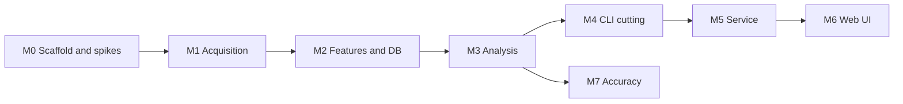

# Roadmap

Each milestone ends with the operator verifying on real data before the next begins.
Work is test-first, with coverage of at least 80% on `core`, `app`, `store` and `io`.
Saved fragments are preferred over live access during development. Test data are the
Python-built envelopes (`env.npy` and others), saved fragments, and cut files already exported
to Plex, all local and loaded through `DALSEGNO_FIXTURES`.

## M0 Scaffold and spikes

Added to the brief's plan, to retire the unverified assumptions cheaply. Results are in
[reference/m0-spikes.md](reference/m0-spikes.md).

- Cargo workspace, lints, `rustfmt`, CI (fmt, clippy, test, coverage).
- `DALSEGNO_FIXTURES` handling (D-19).

| Spike | Question | Outcome if negative |
| --- | --- | --- |
| S1 | What does the origin return for `sq` beyond the head? Is the head fragment complete? | Keep requesting at most head − 1. |
| S2 | Does the hand-written reader plus symphonia's AAC decoder decode saved fragments cleanly across boundaries? | Pipe through ffmpeg in the feature cursor. |
| S3 | Do `tfdt` and Cluster Timecode equal ffprobe `start_time`? | Investigate timescale handling. |
| S4 | Is in-process 2 kHz envelope close to Python's? The Python bins start at the first decoded sample, not on the stream-time grid, so align by offset first. | Accept high correlation instead of equality, and record it. |

**Exit:** spike results recorded in `docs/reference/`, and D-21 confirmed or revised.

## M1 Acquisition

Lease handling, classification, IP family policy, `sq` range fetch and concatenation,
container reader, format detection, `doctor`.

**Exit:** same bytes as the existing `fetch.sh` for one range. Mock-server tests cover 403,
503, empty 200 and expiry. Interrupted fetch resumes.

## M2 Features and database

Migrations, repositories, fragment store, feature runs, envelope, head samples, gaps,
retention holds and sweep.

**Exit:** envelope passes the S4 compatibility check against `env.npy`. Incremental equals
batch.

## M3 Analysis

NCC, `Series`, period, tracking, change signals, baseline diff, self-checks, manual known
material, offline CLI.

**Exit:** the known answers are reproduced from the in-process envelope, which is what shows it
is good enough for analysis. Reproducing them from a Python `.npy` alone does not meet this
exit. Synthetic cases also pass for shrinkage (D-01), harmonics (D-02), song-length net-zero
replacement (D-04) and recording gaps (D-05). Unit tests use synthetic signals, a random series
repeating at a known period and the same series with a section inserted, and period
estimation, lag tracking and version comparison must return the known values.

## M4 Cutting from the CLI

`ensure-range`, candidates, contact sheet, period refinement, assembly, naming, folder
output, transfer, Plex rescan and confirmation.

**Exit:** output matches the naming and folder rules and displays correctly in Plex.
Today's manual process is fully replaced.

## M5 Service and API

`serve`, stream supervisors, job runner, rate limiter, prefetch, change lifecycle,
notification outbox, API, Docker image, CLI switched to the API.

**Exit:** several days running with no holes and no missed change, across a restart.

## M6 Web UI

Dashboard, streams, change detail, boundary editor, export, jobs, settings. Playwright
end-to-end tests for the critical flow.

**Exit:** the flows in the requirements' section 3 complete using only the UI.

## M7 Analysis accuracy

Evaluation harness first, recording baseline scores. Then, in order: segment alignment,
known-material masking and full-history matching, richer features, sub-second boundaries.
May run alongside M5 and M6 after M3.

**Exit:** each replacement beats the recorded baseline, and defaults come from evaluation.

## Risks

| Risk | Impact | Mitigation |
| --- | --- | --- |
| YouTube or yt-dlp changes | Acquisition stops | yt-dlp isolated, automated update path, `error` notification. |
| Bot detection | Stream stalls | Low rate limits, family policy, optional cookies. |
| AAC path mismatch | M2 delayed | S2 and S4 up front, ffmpeg fallback. |
| Analysis accuracy on other streams | False alarms | Human confirmation, self-checks, M7 harness. |
| Format differences in new streams | Cut failures | Probing at registration (D-15). |
| Disk growth | Service failure | Retention, disk floor, visible usage. |
